# redcolumn

**Free, open-source PDF markup and takeoff for construction drawings. It runs in your browser or as a
desktop app, keeps your documents on your device, and needs no account, licence key or subscription.**

Mark up and measure drawings, run takeoffs, compare revisions, manage drawing sets, and share work
with your team through your own OneDrive (experimental) when you choose to. Markups save into standard PDF
annotations, so they open in Bluebeam Revu and other PDF tools.

Use it in the browser at [redcolumn-web.vercel.app](https://redcolumn-web.vercel.app/), no install needed.

## Contents

- [Why redcolumn](#why-redcolumn)
  - [Privacy and local first](#privacy-and-local-first)
  - [Free and open source](#free-and-open-source)
  - [Bluebeam compatibility](#bluebeam-compatibility)
  - [Performance](#performance)
- [How I use it every day](#how-i-use-it-every-day)
- [Features beyond your typical PDF software](#features-beyond-your-typical-pdf-software)
  - [CAD-style editing](#cad-style-editing)
  - [Takeoff with assemblies](#takeoff-with-assemblies)
  - [Compare and overlay revisions](#compare-and-overlay-revisions)
  - [Smart Fill and Symbol Search](#smart-fill-and-symbol-search)
  - [Drawing sets and sheets](#drawing-sets-and-sheets)
  - [Markups list and spreadsheets](#markups-list-and-spreadsheets)
  - [Documents](#documents)
  - [Batch work](#batch-work)
  - [Shared work (experimental)](#shared-work-experimental)
  - [Local MCP server for AI](#local-mcp-server-for-ai)
- [Install the desktop app](#install-the-desktop-app)
  - [Windows](#windows)
  - [Mac](#mac)
  - [Updates](#updates)
  - [Verify your download (optional)](#verify-your-download-optional)
- [Help and documentation](#help-and-documentation)
- [Building from source](#building-from-source)
  - [Repository](#repository)
  - [Releasing the desktop app](#releasing-the-desktop-app)
- [Security](#security)
- [Licence](#licence)
- [Measurements disclaimer](#measurements-disclaimer)
- [Trademarks](#trademarks)

## Why redcolumn

### Privacy and local first

Your drawings are yours. redcolumn is built so that a document only leaves your computer when you
send it somewhere yourself.

- **Your PDFs stay on your device.** Opening, marking up, measuring, OCR, redaction, signing and saving
  all happen in your browser or the desktop app. The project never receives your documents or markups.
- **No redcolumn server.** There is nothing to sign in to, nothing to host, and no copy of your work
  held by the project.
- **No accounts.** You do not register, log in or give an email address to use the app.
- **No licence keys, seats or subscriptions.** The software is Apache License 2.0. Nothing checks in
  with a licence server, and nothing stops working when a trial ends.
- **No analytics, advertising, tracking or error reporting.** The app sets no cookies of its own.
- **Works offline.** Once loaded, the app and your documents work with no internet connection.
  Installed, it runs from its own icon and window.
- **Cloud features are optional and use your own OneDrive.** Live Sessions, Projects and spreadsheet
  sync only start when you sign in to Microsoft, and the files go to your OneDrive, not to us. Live Sessions are encrypted end to end unless the host turns that off. See
  [PRIVACY.md](PRIVACY.md) for exactly what each feature sends and to whom.
- **The local MCP server stays on your computer.** The desktop app can let an AI client you already use
  read the open drawing. It is off until you turn it on, and deletes and document changes wait for
  your approval in redcolumn.

Read the full policy in [PRIVACY.md](PRIVACY.md).

### Free and open source

redcolumn is licensed under the [Apache License 2.0](LICENSE). You can read the source, build it
yourself, change it and use it at work without paying for it. There is no paid tier that unlocks
features. See [Licence](#licence).

### Bluebeam compatibility

redcolumn reads and writes the PDF annotations that Bluebeam Revu uses, so markups travel both ways
with files your team already has. Compatibility is tested against files produced by Revu itself.
The current results are in [docs/compatibility.md](docs/compatibility.md), generated from the
round-trip test suite. Summary (**—** means the test files had no items of that kind, so it is untested
rather than unsupported):

<table>
<thead>
<tr>
<th rowspan="2" align="left">Markup</th>
<th colspan="2">Writes</th>
<th rowspan="2">XFDF round trip</th>
</tr>
<tr>
<th>Save to PDF</th>
<th>Export <code>.bax</code></th>
</tr>
</thead>
<tbody>
<tr><td>Shapes and lines</td><td>Supported</td><td>Supported</td><td>Supported</td></tr>
<tr><td>Measurements</td><td>Supported</td><td>Supported</td><td>Supported</td></tr>
<tr><td>Notes and text</td><td>Supported</td><td>Supported</td><td>Supported</td></tr>
<tr><td>Stamps</td><td>Supported</td><td>Supported</td><td>—</td></tr>
<tr><td>Images</td><td>Supported</td><td>Supported</td><td>Supported</td></tr>
<tr><td>Form fields</td><td>Supported</td><td>— (BAX leaves them out, as Revu does)</td><td>—</td></tr>
<tr><td>Pop-ups</td><td>Supported</td><td>Supported</td><td>—</td></tr>
</tbody>
</table>

Revu tool sets and markup settings files can be imported:

- `.btx` tool sets: read. Most tools come through; a few group shapes are not yet kept.
- `.blx` line styles: read in full.
- `.bhx` hatch sets: read in full.
- `.bpx` markup-list profiles: read in full.

Writing these settings files back out is not built yet.

Compatibility is not a promise that every Revu feature comes through unchanged. Anything that does not
map is listed in the compatibility report, not dropped silently. If you find a file that does not
round-trip, please open an issue with the file or a description of it.

### Performance

redcolumn renders PDFs with PDFium compiled to WebAssembly and runs it in a Web Worker, so drawing
and page work happens off the main thread and the interface stays responsive while a sheet loads. The
desktop app opens and saves files at their real paths, with no upload and download step. When a sheet
is slow to draw because of how it was exported (hundreds of thousands of separate hatch lines, for
example), redcolumn can draw it from an optimised copy. The copy is only used after it has been checked
to look the same as the original, and the file itself never changes.

There is no published head-to-head benchmark against Revu yet. Timings depend heavily on the
machine, the drawing and how it was exported, so we will publish comparisons with the files and
hardware used, rather than general claims.

## How I use it every day

I use this software every day either in my day job or for my house renovations, sketching up designs, doing takeoffs, marking up pictures, etc. I fix bugs as I find them and make improvements as soon as I see an opportunity.

## Features beyond your typical PDF software

redcolumn does markup too. This section covers what it adds: editing and takeoff tools, and features
that work across a whole drawing set. The GIFs and screenshots are from the app itself, on a sample
sheet, and each heading links to its page in the in-app help.

### CAD-style editing

**Edit › Modify** has the commands you know from CAD software like AutoCAD. They act on markups and measurements, snap
to drawing content, and most stay on after each click, so you can work through a sheet. Press
[[Esc]] to finish.

<table>
<tr>
<th colspan="2" align="left">Edit › Modify: the AutoCAD-style commands</th>
</tr>
<tr>
<td width="50%" valign="top">
<br>
<b>Offset</b> makes parallel copies at a set distance, or through a point you click. Good for wall
thicknesses and setbacks. <a href="apps/web/public/help/pages/offset.md">Help</a>
</td>
<td width="50%" valign="top">
<br>
<b>Fillet</b> joins two lines with a rounded arc at the radius you set, or meets them sharp when the
radius is empty. <a href="apps/web/public/help/pages/fillet-chamfer.md">Help</a>
</td>
</tr>
<tr>
<td width="50%" valign="top">
<br>
<b>Chamfer</b> cuts the corner with a straight edge, at a distance you type back along each line.
<a href="apps/web/public/help/pages/fillet-chamfer.md">Help</a>
</td>
<td width="50%" valign="top">
<br>
<b>Mirror</b> flips markups across a line you pick. Keep the original for a mirrored copy, or untick it
to flip the originals. <a href="apps/web/public/help/pages/mirror-rotate.md">Help</a>
</td>
</tr>
<tr>
<td width="50%" valign="top">
<br>
<b>Stretch</b> moves the points inside a crossing window and leaves the rest, so shapes stretch rather
than move whole. <a href="apps/web/public/help/pages/mirror-rotate.md">Help</a>
</td>
<td width="50%" valign="top">
<br>
<b>Trim</b> cuts away the part of a line between the lines that cross it. Hold Shift to extend instead.
<a href="apps/web/public/help/pages/trim-extend.md">Help</a>
</td>
</tr>
<tr>
<td width="50%" valign="top">
<br>
<b>Extend</b> carries a line on until it meets the next markup. Hold Shift to trim instead.
<a href="apps/web/public/help/pages/trim-extend.md">Help</a>
</td>
<td width="50%" valign="top">
<br>
<b>Break</b> takes a gap out of a line between two clicks, or splits it in two when you click the same
point twice. <a href="apps/web/public/help/pages/trim-extend.md">Help</a>
</td>
</tr>
<tr>
<td width="50%" valign="top">
<br>
<b>Join</b> turns lines whose ends meet into one polyline, or a polygon when they close a loop.
<a href="apps/web/public/help/pages/fillet-chamfer.md">Help</a>
</td>
<td width="50%" valign="top">
<br>
<b>Polar Array</b> copies markups round a centre you click, for a set number of items over a set fill
angle. <a href="apps/web/public/help/pages/arrays-divide.md">Help</a>
</td>
</tr>
<tr>
<td width="50%" valign="top">
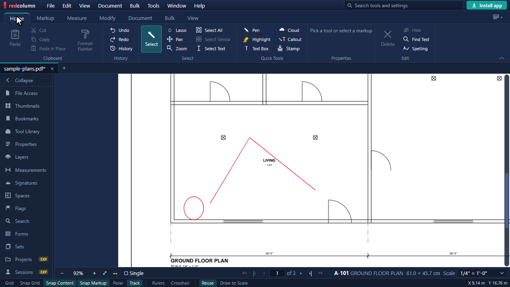<br>
<b>Path Array</b> spaces copies evenly along a line, polyline or outline, and can turn each one to
follow the path. <a href="apps/web/public/help/pages/arrays-divide.md">Help</a>
</td>
<td width="50%" valign="top">
<br>
<b>Multiply</b> makes a grid of evenly spaced copies: columns, rows and the gap between them. Ctrl+Z
undoes the whole grid. <a href="apps/web/public/help/pages/multiply.md">Help</a>
</td>
</tr>
</table>

Also under **Edit › Modify**:

- **Move** and **Copy by Base Point**, with a typed distance or a picked base point.
- **Scale**, by a factor or by reference, and **Scale to Length**, which makes a known length a typed one.
- **Align to Points**, which moves and turns markups so two points land on two targets.
- **Lengthen**, to make a line longer or shorter at one end.
- **Divide / Measure**, which marks a run at equal spacing, to count fixtures along it.
- **Explode**, which splits polylines and polygons into separate lines.
- **Reverse**, which runs lines and arrows the other way, and **Convert to Cloud**, which turns polygons and rectangles into revision clouds.

### Takeoff with assemblies

An **assembly** turns one measurement into the materials it needs. Measure a wall run once, and its
assembly works out the studs, track, board and insulation, each with a waste allowance, rounded up to
whole units and priced if you add unit costs. Each quantity is a formula over the measurement and
named variables, such as a stud spacing or a wall height. Change one variable and every total updates.

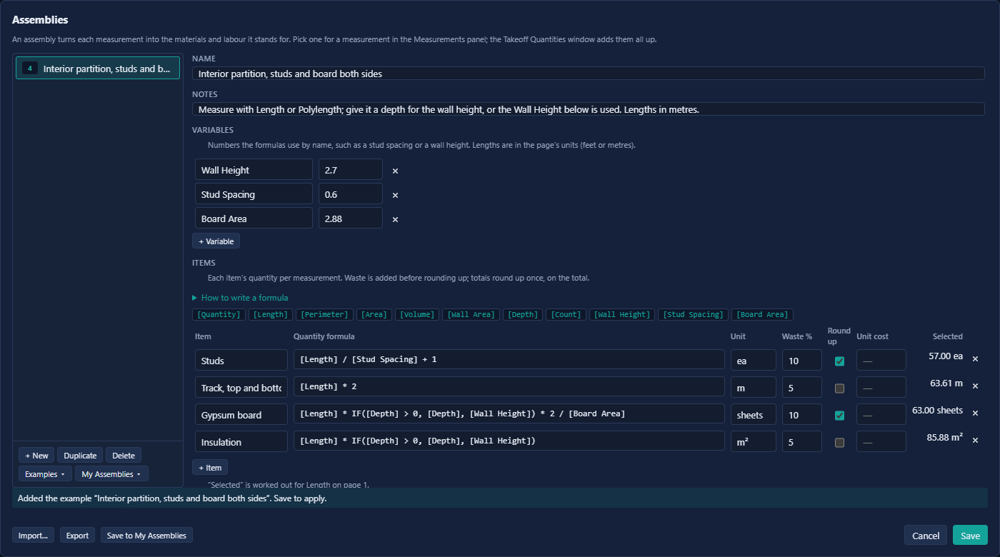

The **Interior partition, studs and board both sides** example, applied to a 30.29 m run of partition
2.7 m high on the sample sheet:

| Item | Quantity formula | Waste | Total |
|---|---|---|---|
| Studs | `[Length] / [Stud Spacing] + 1` | 10% | 57 each |
| Track, top and bottom | `[Length] * 2` | 5% | 63.61 m |
| Gypsum board | `[Length] * IF([Depth] > 0, [Depth], [Wall Height]) * 2 / [Board Area]` | 10% | 63 sheets |
| Insulation | `[Length] * IF([Depth] > 0, [Depth], [Wall Height])` | 5% | 85.88 m² |

To total a takeoff:

1. Select a measurement and pick its assembly in the **Measurements** panel.
2. Repeat for every measurement, then open **Tools › Takeoff › Takeoff Quantities** to add them all up.

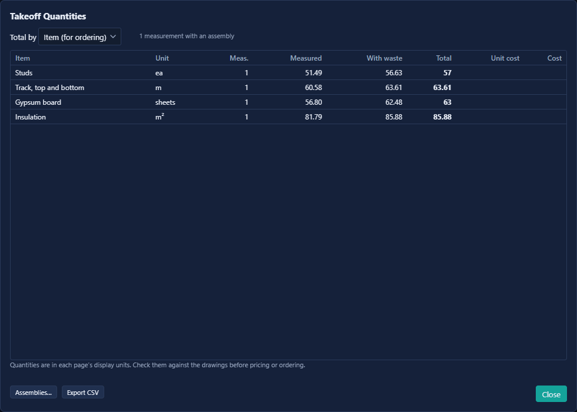

- **By Item (for ordering)** adds the same item together across every assembly. **By Assembly** and
  **By Page** break it down.
- Waste is added before rounding, and rounding happens once on the total. Two walls of 3.1 sheets each
  order 7 sheets, not 8.
- Assemblies are saved in the PDF, and **Save to My Assemblies** keeps a copy you can bring into any
  document. **Export** and **Import…** move them between machines.

Quantities depend on the scale and on your formulas. Check them against the drawings before pricing or
ordering. The [help page](apps/web/public/help/pages/assemblies.md) has the full set of formula
functions.

### Compare and overlay revisions

**Compare** finds every difference between an old and a new revision and clouds it for you.
**Overlay** stacks two revisions on one page in colour: what is the same shows dark, what is only in the
old revision shows red, and what is only in the new one shows blue.

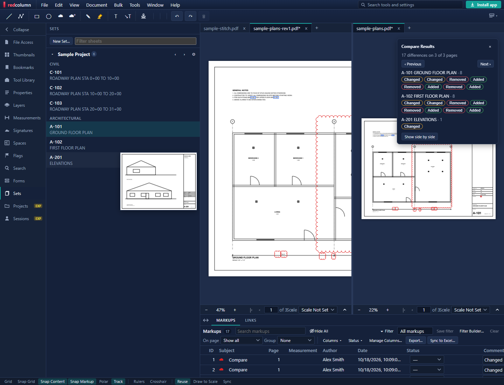

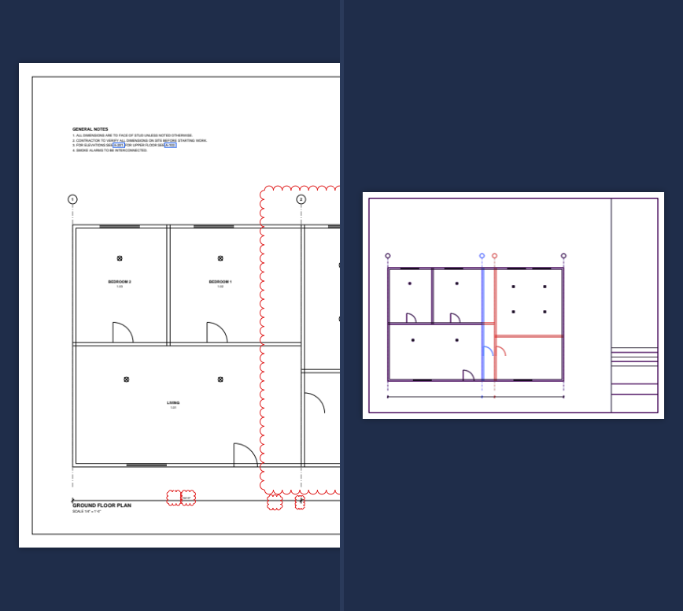

### Smart Fill and Symbol Search

**Smart Fill**: click inside a room and redcolumn finds its walls and draws the outline, much faster
than clicking every corner. **Symbol Search** finds every copy of a symbol (a light fitting, a socket,
a tree) on the page or in the whole document, then counts or marks them all.

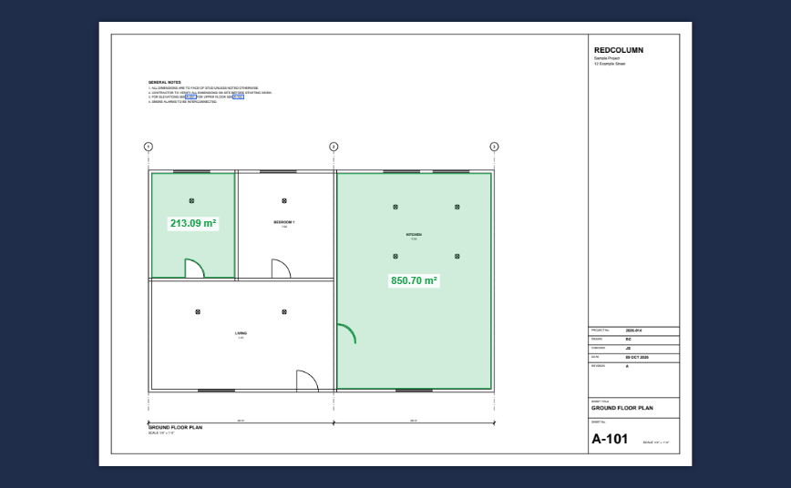

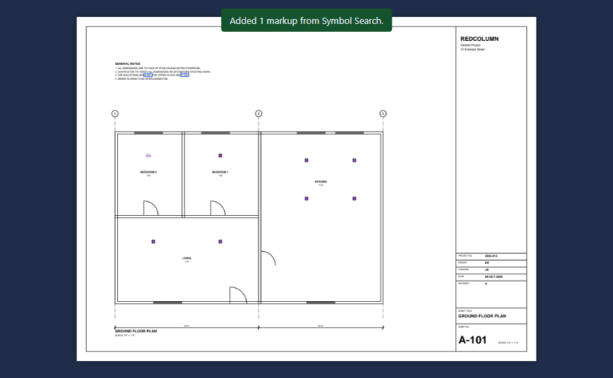

### Drawing sets and sheets

A **Set** lists the sheets of several PDF files as one list, sorted by sheet number. Click a sheet and it
opens, whichever file it is in, so a project issued as one file per discipline reads as one drawing set.
Sheet references in a drawing link to the sheets they point to. **Slip Sheet** brings new revisions into
the set in place of the old ones: each sheet keeps its place and its markups, and the old set is kept as
a revision.

### Markups list and spreadsheets

The Markups list has custom columns, statuses, filters and grouping. Export it as CSV, or as a PDF
summary. **Sync to Excel** writes the list to a workbook in your OneDrive and keeps it up to date as
markups change. Measurements go in as numbers, so the sheet can total them.

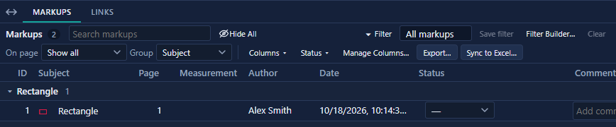

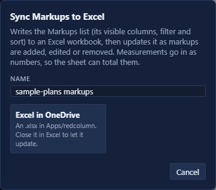

### Documents

- **OCR** makes a scanned drawing searchable and selectable.
- **Redaction** is two steps, mark then apply. Applying it permanently removes the content under the
  mark, then covers it with a box, so the text is not left in the file.
- **Digital signatures** sign with your own certificate, and can check the signatures on a document.
- **Encryption** and **PDF/A** for archiving are in the document tools.

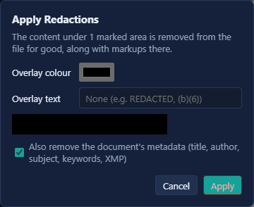

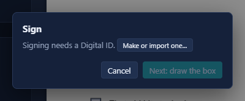

### Batch work

The **Bulk** tab of the ribbon runs one task across many PDFs at once: flatten a whole issue, OCR a
folder of scans, stamp every sheet, set page labels, sign, or print summaries.

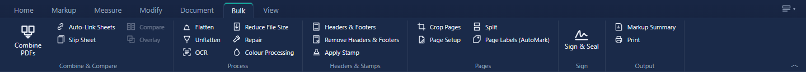

### Shared work (experimental)

**Live Sessions** let several people mark up the same drawings at the same time. Everyone sees each
other's markups as they are made, can chat and send markup alerts, and every action is kept in the
session's Record. Sessions are encrypted end to end by default unless the host turns that off.

**Projects** are shared OneDrive folders of PDFs. People check files out to work on them and check them
back in, every check-in keeps a revision, and a Project Record logs who did what.

Both are experimental, need a Microsoft account and a OneDrive, and only start when you sign in. See
[PRIVACY.md](PRIVACY.md) for what goes where.

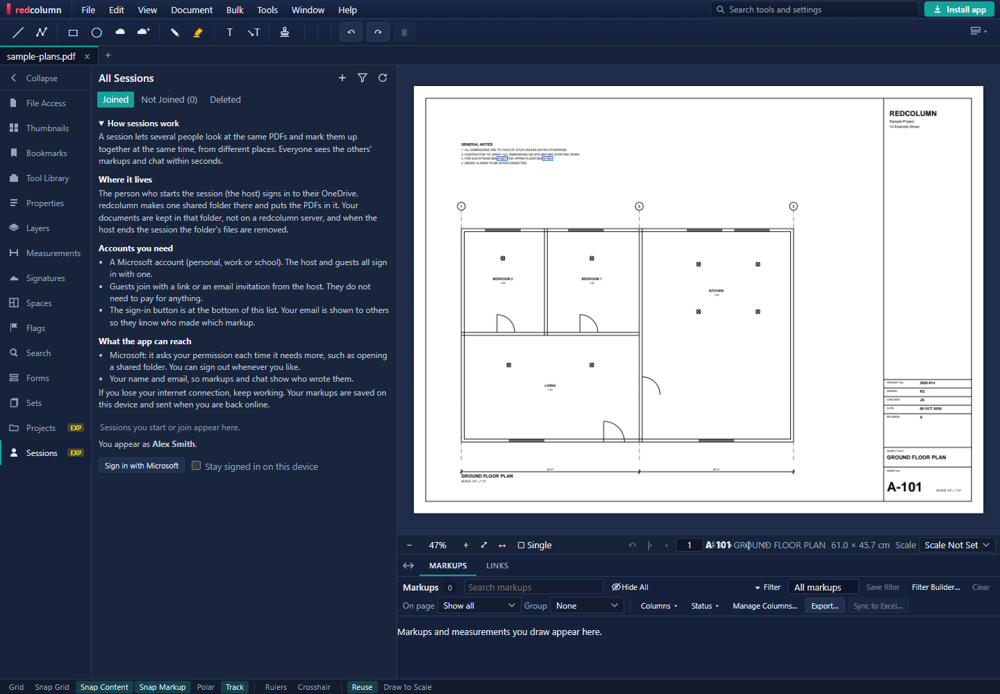

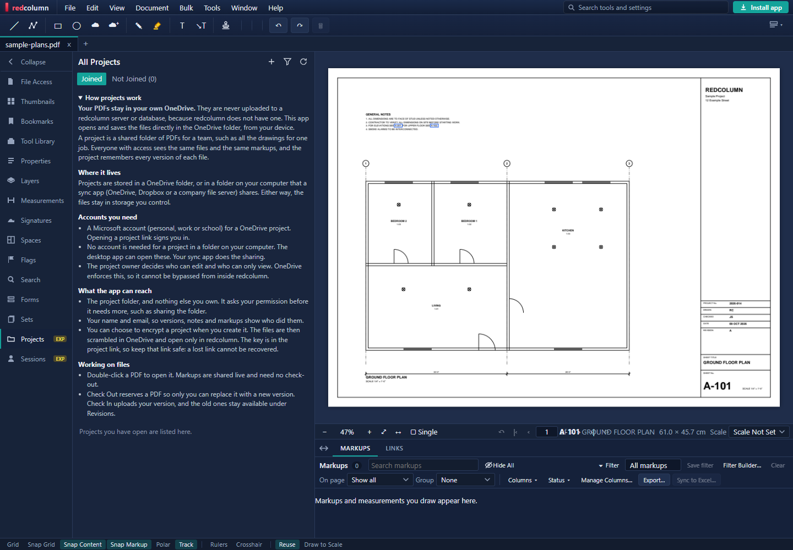

### Local MCP server for AI

The desktop app can let GitHub Copilot, Claude, Codex or Cursor read the open drawing and answer
questions about it. Turn it on in **File › Preferences › MCP**, which shows the command for each client.
Deletes and document changes wait for your approval in redcolumn, and the assistant runs on your
computer. The website does not run it. See [PRIVACY.md](PRIVACY.md).

## Install the desktop app

You can use redcolumn in any modern browser at
[redcolumn-web.vercel.app](https://redcolumn-web.vercel.app/) with nothing to
install. The desktop app adds a window of its own, opens PDFs from File Explorer or Finder and saves
straight back to the same file, and works offline. The downloads are on the
[latest release page](https://github.com/ColbyGallagher/redcolumn/releases/latest).

**The installers are not signed.** redcolumn is free and open source, and it does not buy a code-signing
certificate (Windows) or an Apple Developer ID (Mac). Your computer will therefore warn you the first time
you run it. That warning is about the publisher not being verified, not about the app containing malware.
You can check what you downloaded: the source code is in this repository, and the installers are built from
it by the public [Release workflow](.github/workflows/release.yml) and attached to the release.
Only download redcolumn from the release page above.

### Windows

1. Go to the [latest release](https://github.com/ColbyGallagher/redcolumn/releases/latest), or click
   **Install app** at the top right of the web app, and download **redcolumn-Setup.exe**.
2. Open the file from your Downloads folder. Windows SmartScreen shows **Windows protected your PC**
   because the publisher is unknown. Click **More info**, then **Run anyway**.
3. Follow the steps. The installer does not need administrator rights. It installs for your user
   account by default, and you can choose another folder on the way.
4. Start redcolumn from the Start menu or the desktop shortcut.

To remove it, use **Settings › Apps › Installed apps** and choose redcolumn.

### Mac

Choose the build that matches your processor. Apple menu › **About This Mac** shows which you have.

- **Apple Silicon** (M1 or later): **redcolumn-arm64.dmg**
- **Intel:** **redcolumn-x64.dmg**

1. Download the `.dmg` from the [latest release](https://github.com/ColbyGallagher/redcolumn/releases/latest).
2. Open it and drag **redcolumn** into **Applications**.
3. Open **redcolumn** from Applications. macOS says it cannot be opened because Apple cannot verify it.
   Click **Done**. Do not choose Move to Bin.
4. Open **System Settings › Privacy & Security**, scroll to the message about redcolumn, and click
   **Open Anyway**. Enter your password if asked, then click **Open** on the confirmation. You only need to
   do this once. The button appears for a while after the first attempt, so if it is not there, try opening
   the app again.

If the **Open Anyway** button is missing, or you prefer the command line, you can remove the download
flag from the app in Terminal. Run this only after dragging redcolumn into Applications, and only for a
copy you downloaded from the release page above:

```bash
xattr -dr com.apple.quarantine /Applications/redcolumn.app
```

Then open redcolumn normally.

### Updates

- **Windows:** the installed app checks for a new release a few seconds after launch. When one is ready
  it downloads in the background and shows **Restart to update**. It never restarts over unsaved work,
  and otherwise installs the update when you close the app.
- **Mac:** the app shows **Update to x.y.z** when a new release exists. That button opens the release
  page, and you drag the new version into Applications. Your documents and markups are kept.
- You can check at any time with **Help › Check for Updates**. That asks GitHub for the latest release
  and sends nothing from your documents. See [PRIVACY.md](PRIVACY.md#checking-for-updates-desktop-app).

### Verify your download (optional)

Each installer's SHA-512 checksum is recorded in `latest.yml` on the release, in base64. To compare it
on Windows, run this in PowerShell from the folder you downloaded to, then check the output against the
`sha512` value for `redcolumn-Setup.exe` in `latest.yml`:

```powershell
[Convert]::ToBase64String([System.Security.Cryptography.SHA512]::Create().ComputeHash([System.IO.File]::ReadAllBytes("$PWD\redcolumn-Setup.exe")))
```

## Help and documentation

- **In the app:** Help › Help (F1) has the full user guide, with screenshots, and works offline.
- **Install and offline use:** [install page in the help](apps/web/public/help/pages/install.md).
- **Privacy:** [PRIVACY.md](PRIVACY.md)
- **Bluebeam compatibility report:** [docs/compatibility.md](docs/compatibility.md)
- **Planned work:** [docs/ROADMAP.md](docs/ROADMAP.md)
- **Setting up OneDrive for Live Sessions and Projects:** [docs/CLOUD-SETUP.md](docs/CLOUD-SETUP.md)

## Building from source

redcolumn is a pnpm monorepo. Needs Node.js 22 and pnpm.

```sh
pnpm install
pnpm dev          # the web app
pnpm test
pnpm typecheck
```

To build the desktop app locally, run `pnpm --filter @nb/desktop package` on Windows or
`pnpm --filter @nb/desktop package:mac` on a Mac. The output is written to `apps/desktop/release/`.

The optional settings for OneDrive are listed in `apps/web/.env.example`; `docs/CLOUD-SETUP.md`
explains how to set them up. The user help is in `apps/web/public/help`: Markdown pages in `pages/`, the
contents in `toc.js`. Its screenshots are taken by `scripts/help` from sample drawings (see the header of
`scripts/help/shots.cjs`); re-run it after changing the interface.

### Repository

| Part | What it does |
|---|---|
| `apps/web` | The React app |
| `apps/desktop` | The Electron desktop app, installer and update check |
| `packages/pdf-core` | PDFium (WebAssembly) in a Web Worker: rendering, text, page operations |
| `packages/markup` | Markup model, PDF annotation import and export, XFDF, summaries |
| `packages/measure` | Scales, measurements, snapping, symbol search |
| `packages/sheets` | Sheet number detection and sheet links |
| `packages/stitch` | Stitching sheets along match lines |

### Releasing the desktop app

Raise `version` in `apps/desktop/package.json` (the app compares it with the latest release's tag at
every launch), merge that, then tag the merge commit and push the tag:

```sh
git checkout master && git pull
git tag v0.2.0
git push origin v0.2.0
```

The `Release` workflow (`.github/workflows/release.yml`) checks that the tag is `v` plus the desktop
version, runs the typecheck and tests, builds the Windows installer and both Mac DMGs, and publishes a
GitHub release with `redcolumn-Setup.exe` (plus `redcolumn-Setup.exe.blockmap` and `latest.yml`),
`redcolumn-arm64.dmg` and `redcolumn-x64.dmg` attached. The file names stay fixed so the web app's Install
button, which links to `releases/latest/download/<file>`, always gets the newest release. A tag with a
suffix such as `v0.3.0-beta.1` is published as a pre-release, which the Install button and the update
check ignore.

`latest.yml` and the `.blockmap` must stay attached to the release, or installed Windows apps cannot
update. Running the workflow by hand from the Actions tab builds the installers as workflow artifacts
without publishing. The publish step waits for approval in the `release` environment.

## Security

To report a vulnerability, see [SECURITY.md](SECURITY.md). Please do not open a public issue.

## Licence

redcolumn is licensed under the [Apache License 2.0](LICENSE). See [NOTICE](NOTICE). Third-party
software it includes is listed, with its licences, in
[THIRD_PARTY_NOTICES.md](THIRD_PARTY_NOTICES.md). After changing dependencies, regenerate it with
`node scripts/third-party-notices.mjs`.

Contributions are accepted under the same licence (Apache License 2.0, section 5).

The Apache License does not grant rights to the redcolumn name or logo (section 6).

## Measurements disclaimer

Measurements, quantities and takeoffs depend on the scale and calibration you set and on the drawings
themselves. Check them before relying on them for pricing, ordering or construction. redcolumn is
provided "as is", without warranty of any kind (Apache License 2.0, sections 7 and 8).

## Trademarks

redcolumn is an independent project. It is not affiliated with, endorsed by or sponsored by Bluebeam,
Inc. or Nemetschek SE. Bluebeam and Revu are trademarks of Bluebeam, Inc. Adobe and Acrobat are
trademarks of Adobe Inc. Windows and macOS are trademarks of Microsoft and Apple. These and other names
appear only to describe compatibility and how to install the app.
